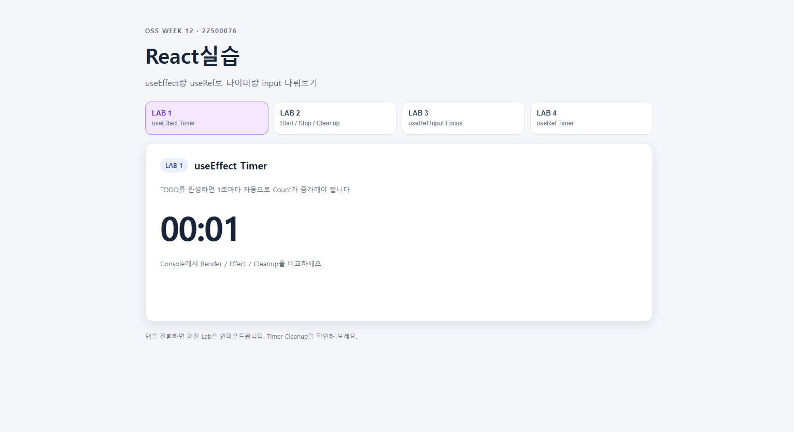
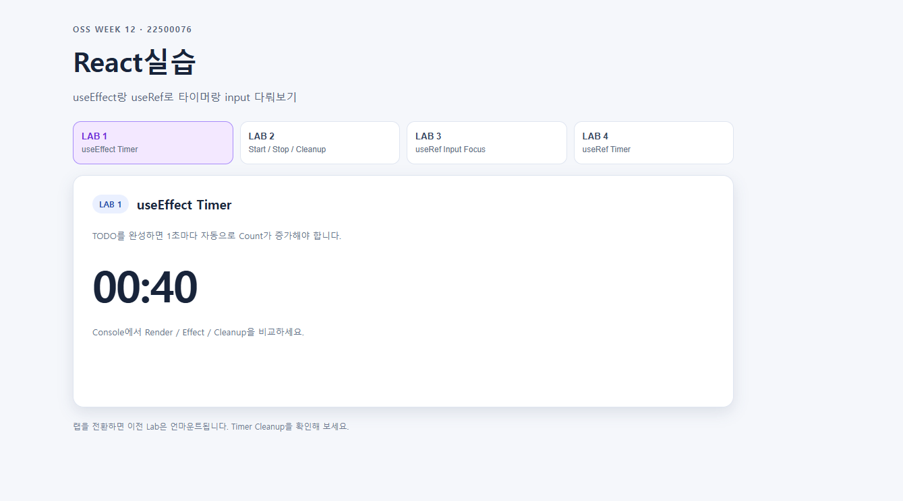
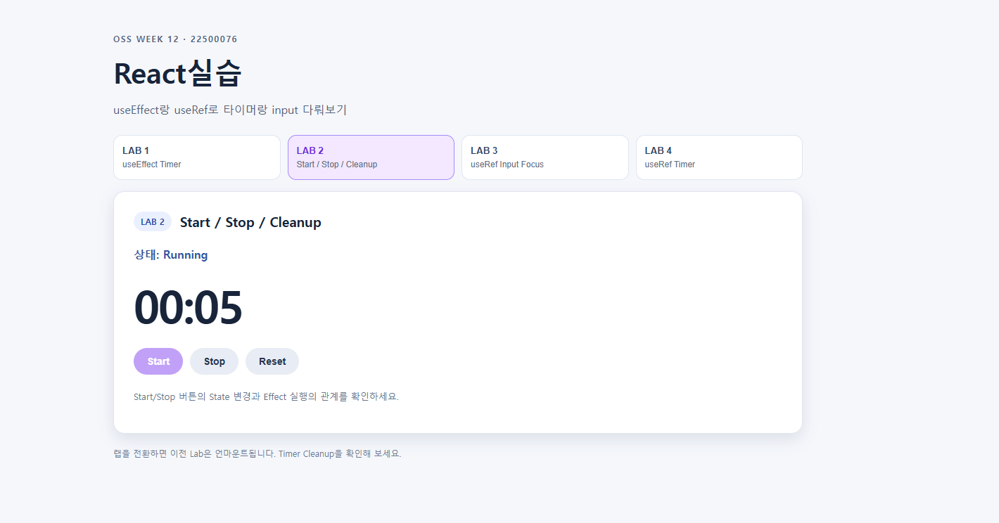
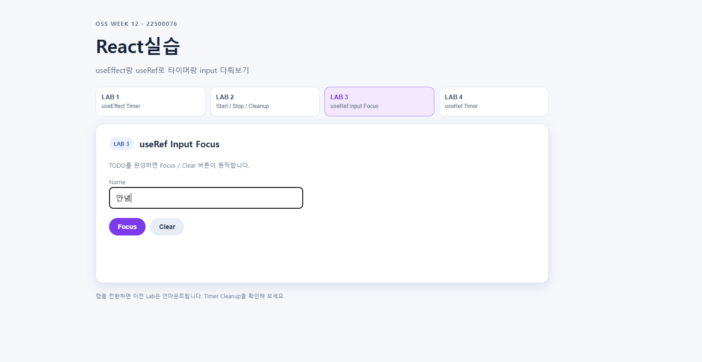
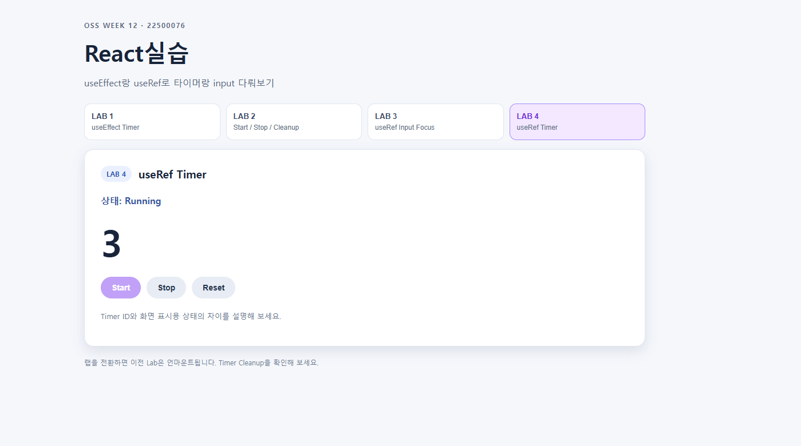

Week 12 - React Hooks 실습
1. Project Information
이번 과제에서는 React의 useEffect와 useRef를 사용하여 4개의 Lab을 구현했습니다.

강의에서 제공한 Starter Project를 기반으로 TODO 부분을 완성했고, 타이머 기능과 Input Focus 기능을 구현했습니다. 추가로 프로젝트 제목과 CSS를 수정했으며, Lab 1과 Lab 2에는 타이머를 분:초 형식으로 표시하는 기능을 적용했습니다.
- Starter Project: https://github.com/2026-2-OSS/week12_starter_project
- My Repository: https://github.com/Flowba104/assign12

# Week 12 - React Hooks 실습
## 2. Installation

프로젝트를 실행하기 위해 저장소를 Clone하고 필요한 패키지를 설치했습니다.

```bash
git clone https://github.com/Flowba104/assign12.git
cd assign12
npm install
npm run dev
```

실행 후 터미널에 표시되는 로컬 주소로 접속하여 Lab 화면을 확인했습니다.

**실행 화면**



## 3. Source Code Exploration

### 프로젝트 구조

- `App.jsx`: 전체 화면과 Lab을 선택하는 탭을 관리합니다.
- `App.css`: 프로젝트의 전체적인 디자인을 담당합니다.
- `Lab1_EffectTimer.jsx`: useEffect를 이용한 기본 타이머입니다.
- `Lab2_TimerControl.jsx`: Start, Stop, Reset이 가능한 타이머입니다.
- `Lab3_InputFocus.jsx`: useRef를 이용한 Input 제어 기능입니다.
- `Lab4_RefTimer.jsx`: useRef로 타이머 ID를 관리하는 타이머입니다.

### useEffect

`useEffect`는 컴포넌트 렌더링 이후에 특정 작업을 실행할 때 사용하는 Hook입니다.

Dependency Array를 통해 Effect가 언제 다시 실행될지 정할 수 있습니다. 빈 배열을 사용하면 마운트 시 실행되고, 특정 state를 넣으면 해당 값이 변경될 때 다시 실행됩니다.

또한 Cleanup 함수를 사용하면 기존에 실행했던 타이머 등을 정리할 수 있습니다.

**주요 코드 - Lab 2**

```jsx
useEffect(() => {
  if (!running) return;

  const timerId = setInterval(() => {
    setCount(prev => prev + 1);
  }, 1000);

  return () => clearInterval(timerId);
}, [running]);
```

이 코드에서는 `running`이 true일 때 타이머가 실행되도록 했습니다. `setInterval`을 통해 1초마다 count가 증가하도록 했으며, running이 변경되거나 컴포넌트가 사라지면 Cleanup을 통해 타이머를 정리하도록 했습니다.

### useRef

`useRef`는 값을 저장하거나 DOM 요소에 접근할 때 사용할 수 있는 Hook입니다.

`useState`와 달리 `.current`의 값이 변경되어도 리렌더링이 발생하지 않습니다. 이번 실습에서는 Input 요소에 접근하거나 타이머 ID를 저장하는 용도로 사용했습니다.

**주요 코드 - Lab 4**

```jsx
const start = () => {
  if (timerRef.current) return;

  timerRef.current = setInterval(() => {
    setCount(prev => prev + 1);
  }, 1000);

  setRunning(true);
};
```

타이머 ID를 `timerRef.current`에 저장하도록 했습니다. 이미 타이머가 실행 중이면 return하도록 하여 중복 실행을 방지했습니다.

## 4. Lab Implementation

### Lab 1 - useEffect Timer

`useEffect`와 `setInterval`을 이용해 1초마다 count가 증가하도록 구현했습니다.

`setCount(prev => prev + 1)`을 사용하여 이전 값을 기준으로 count를 증가시켰으며, Cleanup에서 `clearInterval`을 호출하여 타이머가 정리되도록 했습니다. 화면에는 분:초 형식으로 표시했습니다.



### Lab 2 - Timer Start / Stop

Start, Stop, Reset 버튼을 구현했습니다.

- Start: 타이머를 실행합니다.
- Stop: 타이머를 중지합니다.
- Reset: 타이머를 중지하고 count를 초기화합니다.

`running` state를 사용하여 타이머의 실행 여부를 관리했습니다. Dependency Array에 running을 넣어 상태가 변경될 때 Effect가 다시 실행되도록 했습니다. 타이머는 분:초 형식으로 표시했습니다.



### Lab 3 - Input Focus

`useRef`를 사용하여 Input 요소에 직접 접근하는 기능을 구현했습니다.

Focus 버튼을 누르면 `inputRef.current.focus()`를 통해 입력창으로 포커스가 이동하도록 했습니다.

Clear 버튼은 `.value = ''`로 입력 내용을 지운 뒤 다시 포커스가 이동하도록 구현했습니다.



### Lab 4 - Timer with useRef

Lab 2와 비슷하게 Start, Stop, Reset 기능을 구현했지만, 타이머 ID를 `useRef`로 관리하도록 했습니다.

Start를 누르면 타이머 ID를 저장하고, Stop을 누르면 해당 타이머를 종료한 뒤 ref를 null로 초기화하도록 했습니다.

컴포넌트가 언마운트될 때도 Cleanup을 통해 타이머가 정리되도록 구현했습니다. Lab 4의 실행 화면에서는 count가 초 단위 숫자로 표시됩니다.



## 5. Lab Comparison

### 1. useEffect의 Dependency Array가 필요한 이유

Effect가 언제 다시 실행될지 정하기 위해 필요합니다. Dependency Array가 없으면 렌더링될 때마다 Effect가 실행될 수 있고, 빈 배열이면 마운트 시 실행됩니다.

특정 state를 넣으면 해당 값이 변경되었을 때 Effect가 다시 실행되도록 할 수 있습니다.

### 2. Cleanup을 사용하지 않으면 어떤 문제가 발생하는가?

기존에 실행했던 타이머가 제대로 종료되지 않을 수 있습니다.

특히 컴포넌트가 사라지거나 Effect가 다시 실행될 때 이전 타이머가 남아 있으면 여러 타이머가 동시에 실행되는 문제가 발생할 수 있습니다.

따라서 `clearInterval`을 사용하여 필요 없는 타이머를 정리해야 한다는 것을 알게 되었습니다.

### 3. useState와 useRef의 가장 중요한 차이

`useState`는 값이 변경되면 컴포넌트가 다시 렌더링되지만, `useRef`의 `.current` 값을 변경하는 것만으로는 리렌더링되지 않습니다.

그래서 화면에 표시해야 하는 count나 running은 state로 관리하고, 타이머 ID처럼 화면에 직접 표시할 필요가 없는 값은 ref로 관리하는 것이 적절하다고 이해했습니다.

### 4. Lab 2와 Lab 4의 Timer 관리 방식 차이

Lab 2는 `running` state와 `useEffect`를 이용하여 타이머를 관리했습니다.

반면 Lab 4는 `useRef`에 타이머 ID를 저장하고 버튼 함수에서 직접 타이머를 실행하거나 중지하도록 구현했습니다.

두 Lab 모두 같은 타이머 기능을 구현했지만, 타이머를 관리하는 방식에 차이가 있다는 것을 확인했습니다.

## 6. Customizing

기본 Lab 구현 이후 프로젝트의 제목과 CSS를 일부 변경했습니다.

**수정 파일**

- `App.jsx`: 프로젝트 제목과 설명을 변경했습니다.
- `App.css`: 제목 위 글씨 색상, 선택된 탭 색상, 버튼 디자인을 수정했습니다.
- 시간 변환 함수 파일: 초 단위 시간을 분:초 형식으로 변환하는 함수를 추가했습니다. (실제 파일 경로 확인 필요)
- `Lab1_EffectTimer.jsx`, `Lab2_TimerControl.jsx`: 시간 표시 형식을 변경했습니다.

추가 기능으로 Lab 1과 Lab 2의 타이머 count를 `00:00` 형식으로 표시하도록 했습니다. Lab 4는 현재 초 단위 숫자로 표시됩니다.

## 7. Deployment

GitHub Repository에 작업한 코드를 Push하고 Vercel을 이용하여 배포했습니다.

- GitHub: https://github.com/Flowba104/assign12
- Vercel: https://assign12-ten.vercel.app/

배포된 페이지에서 각 Lab의 실행 화면을 확인할 수 있습니다. (자동 배포 및 전체 버튼 동작은 별도 확인 필요)

## 8. Weekly Review

### 새롭게 배운 내용

1. `useEffect`의 Dependency Array에 따라 Effect가 실행되는 시점이 달라진다는 것을 배웠습니다.
2. Cleanup을 사용하여 타이머와 같은 작업을 정리하는 방법을 배웠습니다.
3. `useRef`를 사용하면 DOM 요소에 직접 접근하거나 리렌더링 없이 값을 저장할 수 있다는 것을 알게 되었습니다.

### 어려웠던 점과 해결 방법

Lab 2를 구현하면서 reset 함수에 빨간 줄이 표시되는 문제가 있었습니다. 확인해 보니 기존에 선언된 reset 함수를 지우지 않고 새로운 함수를 추가하여 중복 선언된 것이 원인이었습니다. 기존 TODO 부분을 수정하는 방식으로 해결했습니다.

Lab 3에서는 Input 태그를 수정하는 과정에서 기존 태그를 남겨두고 새로운 태그를 추가하는 실수가 있었습니다. 이후 중복된 태그를 제거하고 기존 Input에 ref 속성을 연결하여 해결했습니다.

### AI 활용 내용 및 느낀 점

이번 과제에서는 AI를 활용하여 Hook의 동작 원리를 이해하고 TODO 부분의 구현 방향을 확인했습니다.

특히 `useEffect`의 Cleanup과 `useRef.current`의 사용 방법을 이해하는 데 도움을 받았으며, 코드 작성 중 발생한 오류의 원인을 찾을 때도 활용했습니다. README 초안 작성 및 문장 수정에도 AI를 사용했습니다.

단순히 코드를 작성하는 것뿐만 아니라 각 Hook이 어떤 역할을 하고 왜 필요한지 이해하는 것이 중요하다고 느꼈습니다.
